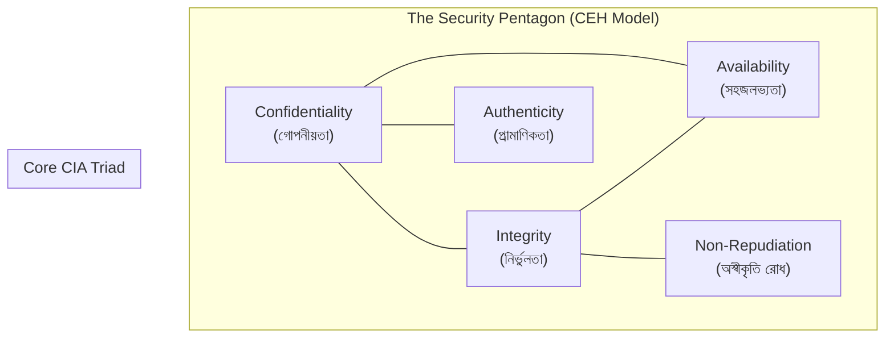

# 1. Elements of Information Security ★★★

> **কোর্স:** Ethical Hacking (ECH)  
> **মডিউল:** Module 01 — Introduction to Information Security & Hacking Basics  
> **পরীক্ষার গুরুত্ব:** ★★★ (3 Stars — বারবার আসা গুরুত্বপূর্ণ থিওরি প্রশ্ন)

---

## 📌 সংক্ষেপে মূল ধারণা (At a Glance)
**Information Security (তথ্য নিরাপত্তা)** বলতে বোঝায় অননুমোদিত প্রবেশাধিকার (unauthorized access), তথ্য প্রকাশ (disclosure), পরিবর্তন (modification), ক্ষতিসাধন (destruction) বা ব্যবহার থেকে ডেটা ও তথ্য ব্যবস্থাকে সুরক্ষিত রাখা।

EC-Council (CEH v13) স্ট্যান্ডার্ড অনুসারে Information Security-এর মূল স্তম্ভ হলো **৫টি উপাদান (5 Elements)**। এগুলোকে একত্রে **Security Pentagon (নিরাপত্তা পঞ্চভুজ)** বলা হয়। এর প্রথম ৩টি উপাদানকে নিয়ে গঠিত হয় ক্লাসিক্যাল **CIA Triad**।

```
                  [ Authenticity ]
                       /\
                      /  \
     [ Confidentiality ]  [ Integrity ]
             \               /
              \             /
        [ Availability ]---[ Non-Repudiation ]
```

---

## 🛡️ ৫টি মূল উপাদান (The 5 Core Elements)

### ১. Confidentiality (গোপনীয়তা)
* **সংজ্ঞা (Definition):** নিশ্চিত করে যে সংবেদনশীল তথ্য কেবল অনুমোদিত ব্যক্তি (authorized users), প্রক্রিয়া বা ডিভাইসের কাছেই দৃশ্যমান হবে এবং অননুমোদিত কারো কাছে প্রকাশ পাবে না।
* **মূল উদ্দেশ্য:** ডেটা চুরি বা অননুমোদিত তথ্য ফাঁস (data leak) রোধ করা।
* **প্রতিরক্ষা কৌশল (Controls):**
  * ডেটা এনক্রিপশন (AES-256, RSA) — Data at rest এবং Data in transit অবস্থায়।
  * Access Control List (ACL) এবং Least Privilege Policy।
  * Multi-Factor Authentication (MFA)।
* **সাধারণ আক্রমণ (Attacks):**
  * Eavesdropping / Sniffing (নেটওয়ার্ক ট্রাফিক গোপনভাবে শোনা)।
  * Man-in-the-Middle (MitM)।
  * Social Engineering / Phishing।

---

### ২. Integrity (সততা / নির্ভুলতা)
* **সংজ্ঞা (Definition):** তথ্যের সঠিকতা (accuracy), পরিপূর্ণতা (completeness) এবং বিশ্বস্ততা নিশ্চিত করে। এটি প্রমাণ করে যে ডেটা সংরক্ষণ বা স্থানান্তরের সময় অননুমোদিতভাবে পরিবর্তিত, ধ্বংস বা বিকৃত হয়নি।
* **মূল উদ্দেশ্য:** ডেটা যাতে কেউ বদলে দিতে না পারে বা টেম্পার (tampering) না করতে পারে।
* **প্রতিরক্ষা কৌশল (Controls):**
  * Cryptographic Hash Functions (SHA-256, MD5)।
  * Digital Signatures (ডিজিটাল স্বাক্ষর)।
  * Checksum ভ্যালিডেশন এবং File Integrity Monitoring (FIM)।
* **সাধারণ আক্রমণ (Attacks):**
  * Data Tampering (ডেটা বিকৃত করা)।
  * Replay Attacks।
  * Bit-flipping বা অননুমোদিত ডেটাবেস পরিবর্তন।

---

### ৩. Availability (সহজলভ্যতা)
* **সংজ্ঞা (Definition):** নিশ্চিত করে যে অনুমোদিত ব্যবহারকারীরা যখনই প্রয়োজন তখনই সিস্টেম, নেটওয়ার্ক এবং ডেটাতে নিরবচ্ছিন্নভাবে প্রবেশাধিকার (access) পাবে।
* **মূল উদ্দেশ্য:** সিস্টেম ডাউনটাইম রোধ করা এবং ২৪/৭ সার্ভিস চালু রাখা।
* **প্রতিরক্ষা কৌশল (Controls):**
  * Hardware Redundancy (অতিরিক্ত ব্যাকআপ সার্ভার, RAID অ্যারে)।
  * Load Balancing এবং High Availability (HA) ক্লাস্টার।
  * নিয়মিত ডেটা ব্যাকআপ ও Disaster Recovery Plan (DRP)।
  * DDoS প্রটেকশন / স্ক্রাবিং সেন্টার (যেমন Cloudflare)।
* **সাধারণ আক্রমণ (Attacks):**
  * Denial-of-Service (DoS) এবং Distributed DoS (DDoS)।
  * Ransomware (ফাইল এনক্রিপ্ট করে এক্সেস বন্ধ করা)।
  * ফিজিক্যাল ড্যামেজ বা পাওয়ার বিভ্রাট।

---

### ৪. Authenticity (প্রামাণিকতা / সত্যতা)
* **সংজ্ঞা (Definition):** কোনো মেসেজ, লেনদেন বা সংযোগের উৎস প্রকৃত এবং আসল তা যাচাই করা। অর্থাৎ প্রেরক বা ব্যবহারকারী দাবি করছেন তিনি আসলে সেই ব্যক্তি বা সিস্টেম কি না তা নিশ্চিত করা।
* **মূল উদ্দেশ্য:** কোনো ছদ্মবেশ ধারণকারী (impersonator) যেন সিস্টেমে ঢুকতে না পারে।
* **প্রতিরক্ষা কৌশল (Controls):**
  * Digital Certificates (SSL/TLS সার্টিফিকেট, X.509)।
  * Public Key Infrastructure (PKI)।
  * Biometric Authentication (ফিঙ্গারপ্রিন্ট, ফেসিয়াল রিকগনিশন)।
  * স্মার্ট কার্ড ও ক্রিপ্টোগ্রাফিক টোকেন।
* **সাধারণ আক্রমণ (Attacks):**
  * IP Spoofing / MAC Spoofing।
  * Credential Stuffing ও Identity Theft।
  * Phishing ও ছদ্মবেশ (Impersonation)।

---

### ৫. Non-Repudiation (অস্বীকৃতি রোধ)
* **সংজ্ঞা (Definition):** এমন একটি নিশ্চয়তা যেখানে কোনো ব্যক্তি বা সিস্টেম কোনো কাজ, মেসেজ প্রেরণ বা লেনদেন সম্পন্ন করার পর তা অস্বীকার (deny/repudiate) করতে পারে না।
* **মূল উদ্দেশ্য:** কোনো লেনদেন বা কাজের আইনি ও প্রযুক্তিগত অনস্বীকার্য প্রমাণ রাখা।
* **প্রতিরক্ষা কৌশল (Controls):**
  * Digital Signature (প্রেরকের প্রাইভেট কি দিয়ে সাইন করা)।
  * Audit Logs এবং Syslog সার্ভার (Immutable / Read-only লগ)।
  * Certified Timestamping (RFC 3161 টাইমস্ট্যাম্পিং অথরিটি)।
* **সাধারণ আক্রমণ (Attacks):**
  * লেনদেন অস্বীকার করা (Denial of financial transaction)।
  * লগ ফাইল মুছে ফেলা বা পরিবর্তন করা (Log tampering / Cover tracks)।

---

## 📊 CIA Triad বনাম Security Pentagon



* **CIA Triad:** মূলত প্রাথমিক তিনটি মৌলিক স্তম্ভ— Confidentiality, Integrity, Availability।
* **Security Pentagon:** আধুনিক সাইবার নিরাপত্তা ও CEH ফ্রেমওয়ার্কে CIA-এর সাথে Authenticity এবং Non-Repudiation যুক্ত হয়ে পূর্ণাঙ্গ ৫টি স্তম্ভ গঠিত হয়।

---

## 📋 সামারি কম্প্যারিজন টেবিল (Quick Revision)

| উপাদান (Element) | মূল প্রতিপাদ্য (Core Principle) | মূল প্রযুক্তি / কন্ট্রোল (Defense Controls) | সাধারণ অ্যাটাক ভেক্টর (Attacks) |
|---|---|---|---|
| **Confidentiality** | তথ্য কেবল অনুমোদিত চোখেই যাবে | Encryption (AES, RSA), ACL, MFA | Sniffing, Data Leak, MitM |
| **Integrity** | তথ্য কেউ পরিবর্তন করেনি | Hash (SHA-256), Digital Signature | Data Tampering, Replay Attack |
| **Availability** | তথ্য ও সিস্টেম সর্বদাই সচল | Redundancy, RAID, Load Balancer, DRP | DoS / DDoS, Ransomware |
| **Authenticity** | পরিচয় আসল ও যাচাইকৃত | SSL/TLS, Biometrics, PKI Certs | Spoofing, Impersonation |
| **Non-Repudiation** | কেউ কাজ করে অস্বীকার করতে পারবে না | Digital Signature, Audit Logs, TSA | Log Manipulation, Repudiation |

---

## 🎯 পরীক্ষার খাতায় উত্তর লেখার টিপস
1. **শুরুতে সংজ্ঞা দিন:** Information Security কাকে বলে তা ১-২ লাইনে লিখুন।
2. **ডায়াগ্রাম আঁকুন:** উত্তরের শুরুতে অবশ্যই **Security Pentagon** বা **CIA Triad**-এর সুন্দর একটি চিত্র আঁকবেন। পরীক্ষক এতে ফুল মার্কস দেন।
3. **প্রতিটি উপাদানের ৩টি অংশ রাখুন:**
   - Definition (সংজ্ঞা)
   - Real-world Protection / Controls (প্রতিরক্ষা প্রযুক্তি)
   - Targeted Attacks (কোন আক্রমণে এটি ক্ষতিগ্রস্ত হয়)
4. **CIA ও Pentagon এর পার্থক্য:** উল্লেখ করবেন যে ৩টি উপাদান নিয়ে CIA গঠিত এবং অতিরিক্ত ২টি (Authenticity ও Non-Repudiation) যোগ হয়ে পেন্টাগন তৈরি করে।

